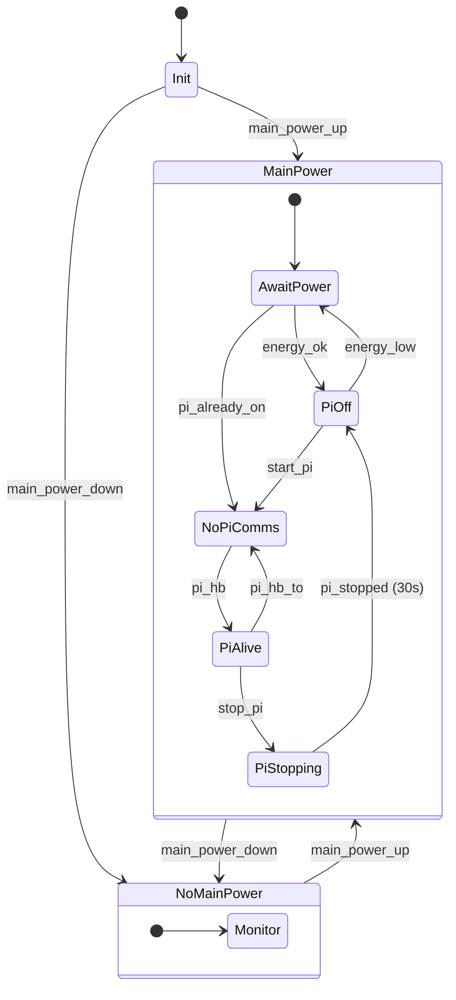

# Compute

- Initial tests used a Raspberry Pi Zero 2 W board as the main compute, but the 512MB of memory proved for containerized InfluxDB and Telegraf, never mind Grafana or actual application logic. 
- Testbed development now proceeding with a Raspberry Pi 3+ (1GB memory), which is performing better. 
- 8GB Raspberry Pi 4 on order.

## Components

- Raspberry Pi 4 Model B with 8GB memory
    - USB-connected GPS
    - RP2040 (below)
        - UART connection for operational data
        - USB connection for programming only. Its 5V (VBUS) line must be cut: the RP2040 runs from its own supply, and a live VBUS back-powers the Pi through its USB port, so the relay can no longer switch the Pi off.

- RP2040 Feather microcontroller running MicroPython
    - UART-connected Victron MPPT
    - I2C-connected INA260 current/voltage monitor reading main battery voltage and aggregate load of compute and sensors
    - I2C-connected 9-DOF IMU
    - propulsion motor ESC
    - rudder servo

## System States

There are two compute elements of interest when it comes to understanding the overall system state: the RP2040 microcontroller and the RPi 4 main compute. The former manages basic power system data collection and control, and will be powered on as long as any energy is available in either the main battery or the low-voltage backup battery. The RPi provides long-term data retention, tracking, planning, and communications, and may or may not be powered on at any given time, depending on main battery power availability. It may be shut down preemptively to conserve power, and is not served by the low-voltage backup.

### Power safety rules

The RP2040 must be able to restart, crash, or be reprogrammed without taking the Pi down with it, and must never leave the Pi half-powered.

- The Pi's power relay (GPIO11, high = on) has a 10k pull-up to 3.3V, so it stays on while the RP2040 is in reset. `boot.py` then drives it high before anything else runs.
- The firmware only cuts Pi power deliberately: on loss of main power, or after a requested shutdown. Startup leaves the relay as it finds it.
- No other connection may supply power to the Pi while the relay is off (see the USB note above). With the relay off, the Pi's red LED must go fully dark.
- The watchdog is fed only while the main loop is running, so a crash or hang ends in a reset. Interrupting the main loop from the console (Ctrl-C, as a deploy does) holds the watchdog off for 15 minutes. A `nowdt` file on the RP2040 disables it for bench work.
- After three consecutive boots that crash before running healthily for a minute, the RP2040 comes up in safe mode: watchdog off, Pi powered, REPL free for a deploy to repair it. Crashes are logged to `crash.log` on the RP2040.

### States

- Init: initial state, where no information about the system is yet available. The Pi's power is left alone until the first battery voltage reading.
- NoMainPower: superstate encompassing all operations where the main battery is exhausted or too low a voltage. Entering it cuts power to the Pi and the drive.
  - Monitor: stable state wherein the RP2040 is monitoring and recording power levels but the ship is otherwise idle, waiting for sufficient power to be available for normal operations.
- MainPower: the main battery is above the main-power threshold (12.6V up, 12.4V down).
  - AwaitPower: not enough energy to start the Pi. If the Pi is already running (for example after an RP2040 reset), it is left running and the state moves to NoPiComms.
  - PiOff, NoPiComms, PiAlive, PiStopping: the Pi's lifecycle.

The battery voltage comes from the Victron MPPT, or from the INA260 when the MPPT hasn't reported for 30 seconds.

