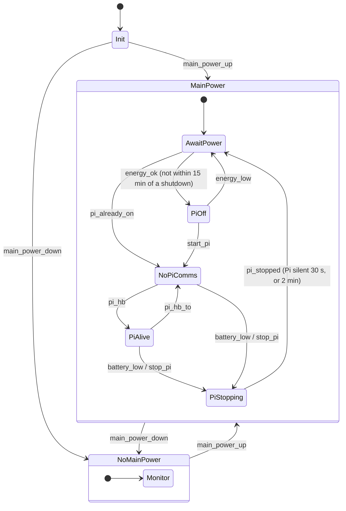

# Compute

- Initial tests used a Raspberry Pi Zero 2 W board as the main compute, but the 512MB of memory proved for containerized InfluxDB and Telegraf, never mind Grafana or actual application logic. 
- Testbed development now proceeding with a Raspberry Pi 3+ (1GB memory), which is performing better. 
- 8GB Raspberry Pi 4 on order.

## Components

- Raspberry Pi 4 Model B with 8GB memory
    - RP2040 (below)
        - UART connection for operational data
        - USB connection: a fallback for programming only; deploys normally go over the UART (see `tools/README.md`). Its 5V (VBUS) line must be cut: the RP2040 runs from its own supply, and a live VBUS back-powers the Pi through its USB port, so the relay can no longer switch the Pi off.

- RP2040 Feather microcontroller running MicroPython
    - UART-connected Victron MPPT
    - I2C-connected INA260 current/voltage monitor reading main battery voltage and aggregate load of compute and sensors
    - I2C-connected 9-DOF IMU (I2C0, GPIO 12/13)
    - I2C-connected GPS: Adafruit Mini GPS PA1010D on the STEMMA QT connector (I2C1, GPIO 2/3, shared with the INA260). The RP2040 keeps position and UTC while the Pi is off, and timestamps its messages (`utc_ms`) once it has a fix.
    - propulsion motor ESC
    - rudder servo

## System States

There are two compute elements of interest when it comes to understanding the overall system state: the RP2040 microcontroller and the RPi 4 main compute. The former manages basic power system data collection and control, and will be powered on as long as any energy is available in either the main battery or the low-voltage backup battery. The RPi provides long-term data retention, tracking, planning, and communications, and may or may not be powered on at any given time, depending on main battery power availability. It may be shut down preemptively to conserve power, and is not served by the low-voltage backup.

### Power safety rules

The RP2040 must be able to restart, crash, or be reprogrammed without taking the Pi down with it, and must never leave the Pi half-powered.

- The Pi's power relay (GPIO11, high = on) must stay on while the RP2040 is in reset, so that an RP2040 restart doesn't cut a running Pi. **It doesn't yet.** A 10k pull-up to 3.3V turned out too weak to drive the relay's input on its own (measured 2026-10-11: with the pin in its reset state, the Pi's supply current fell by the whole of its draw). Until the relay gets a driver that holds it on through a reset (for example a logic-level MOSFET with a gate pull-up), any RP2040 reset briefly cuts the Pi, and firmware updates use `tools/deploy.sh --flash-halt`.
- `boot.py` settles the relay before anything else runs (`power_policy.py`):
  - Power-on reset (a cold start, including the reset button): Pi off. The whole system may be waking at dawn on a nearly empty battery, and the Pi must not start, brown out, and repeat. It starts only when the FSM's energy rules allow.
  - Watchdog reset (a crash, a hang, or the reset at the end of a deploy): restore the relay state the firmware last chose deliberately, which it records in a `pi_power` file on each change.
  - Soft reset (Ctrl-D): leave the relay alone.
- The firmware only changes Pi power deliberately: starting it when energy allows, and cutting it on loss of main power or after a requested shutdown.
- Once the relay holds through a reset, it will also be on for the moment between the RP2040 powering up and `boot.py` running. At a dawn wake-up that only happens once the MPPT's load output has reconnected.
- No other connection may supply power to the Pi while the relay is off (see the USB note above). With the relay off, the Pi's red LED must go fully dark.
- The watchdog is fed only while the main loop is running, so a crash or hang ends in a reset. Interrupting the main loop from the console (Ctrl-C, as a deploy does) holds the watchdog off for 15 minutes. A `nowdt` file on the RP2040 disables it for bench work.
- After three consecutive boots that crash before running healthily for a minute, the RP2040 comes up in safe mode: watchdog off, relay left as `boot.py` set it, REPL free for a deploy to repair it. Safe mode retries normal operation after an hour, and puts the REPL on the UART. Crashes are logged to `crash.log` on the RP2040.
- If the firmware fails before it's running (for example a broken import), `main.py` reports `startup_failed` to the Pi and moves the REPL onto the UART. Every failure short of a hang before the watchdog starts can therefore be repaired with a serial deploy, without USB.

### Time and telemetry

- The RP2040 keeps UTC from the GPS and stamps every message with it (`utc_ms`). The Pi's monitor writes points with that time, and feeds the GPS time from live fixes to chrony as a reference clock, so the Pi's clock is right without the internet. Internet NTP is preferred when it's reachable, because GPS time without a PPS signal is only good to about 0.1 s.
- The monitor sends a heartbeat (`{"cmd": "hb", "ack": N}`) every 2 s over the UART. Without one for 10 s, the RP2040 treats the Pi as down. Its FSM moves from PiAlive to NoPiComms, and every 30 s it stores a snapshot of its latest readings and status on flash (`telemetry_log.py`, capped at 2 MB, dropping the oldest first). When heartbeats resume, it replays the log alongside live data. `ack` is the highest replayed sequence number the monitor has written to InfluxDB; records are deleted only once acknowledged.
- Every status record carries `pi_up`, and records made while the Pi is down are replayed, so the Pi's up/down history in `rp2040_status` has no gaps.

### States

- Init: initial state, where no information about the system is yet available. The Pi's power is left alone until the first battery voltage reading.
- NoMainPower: superstate encompassing all operations where the main battery is exhausted or too low a voltage. Entering it cuts power to the Pi and the drive.
  - Monitor: stable state wherein the RP2040 is monitoring and recording power levels but the ship is otherwise idle, waiting for sufficient power to be available for normal operations.
- MainPower: the main battery is above the main-power threshold (12.6V up, 12.4V down).
  - Low battery: once the battery has stayed below 12.8 V for 2 minutes (roughly 15-20% charge for LiFePO4 at these loads), the RP2040 shuts the Pi down cleanly. It asks the monitor to power off over the UART, waits until the Pi has been silent for 30 s (or 2 minutes at most), cuts its power, and goes to AwaitPower. The rest of the battery keeps the RP2040 and GPS running and logging.
  - Restart: the Pi is started again only when energy is OK (battery above 13.5 V, or more than 10 W of solar) and the battery is at least 13.0 V, and not within 15 minutes of a deliberate shutdown.
  - AwaitPower: not enough energy to start the Pi. If the Pi is already running (for example after an RP2040 reset), it is left running and the state moves to NoPiComms.
  - PiOff, NoPiComms, PiAlive, PiStopping: the Pi's lifecycle.

The battery voltage comes from the Victron MPPT, or from the INA260 when the MPPT hasn't reported for 30 seconds.

